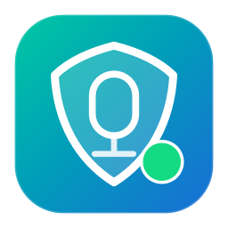

# HeadsetMicGuard

HeadsetMicGuard is a lightweight macOS menu bar app that keeps your preferred microphone selected.

It is built for the common AirPods workflow: keep AirPods as the output device, but force macOS input back to the MacBook microphone when Bluetooth reconnects or automatic device switching changes the default input.

## Status

Active small-utility release. Current public release: `v1.0`.

## Screenshot / Demo



A menu bar screenshot/GIF is planned for a future documentation update.

## Features

- Runs as a menu bar app with no Dock icon.
- Watches macOS audio device changes through CoreAudio notifications.
- Keeps only the default input device pinned; it never changes output devices.
- Lets you choose any available input device as the preferred microphone.
- Falls back to the built-in microphone when the preferred device is unavailable.
- Includes Pause, Force Now, Refresh Devices, Launch at Login, and Quit controls.
- Does not record audio.

## Requirements

- macOS 13 Ventura or newer.
- Xcode 26.5 or newer to build from source.

## Install

1. Download the latest `HeadsetMicGuard-1.0.dmg` from [GitHub Releases](https://github.com/ForkHorizon/HeadsetMicGuard/releases).
2. Open the DMG.
3. Drag `HeadsetMicGuard.app` to `Applications`.
4. Launch HeadsetMicGuard once from `Applications`.
5. Open the menu bar icon, choose your preferred microphone, and optionally enable `Launch at Login`.

Unsigned development builds may be blocked by Gatekeeper. If macOS blocks the app, right-click `HeadsetMicGuard.app`, choose `Open`, and confirm the prompt. You can also approve it in `System Settings -> Privacy & Security`.

## Usage

The menu bar icon reflects the current guard state:

- Guarding: the preferred microphone is already the default input.
- Switching: macOS changed input and HeadsetMicGuard is restoring it.
- Paused: enforcement is disabled until resumed.
- Preferred unavailable: the saved preferred microphone is missing, so the app uses the built-in input as a temporary fallback.
- Needs attention: CoreAudio, signing, or launch-at-login setup returned an error.

Menu actions:

- `Preferred Microphone`: selects the input device HeadsetMicGuard keeps active.
- `Pause Guard` / `Resume Guard`: temporarily disables or enables enforcement.
- `Force Now`: immediately restores the preferred input.
- `Refresh Devices`: reloads the current CoreAudio input device list.
- `Enable Launch at Login`: starts HeadsetMicGuard automatically after login.

## Troubleshooting

### AirPods are still the speakers

That is expected. HeadsetMicGuard only changes the default input device. It does not touch output or system output, so AirPods can remain selected for sound.

### My preferred microphone disappeared

If the saved preferred device is unavailable, HeadsetMicGuard temporarily uses the built-in microphone. It does not overwrite your saved preferred device, so the original choice is used again when it returns.

### macOS says the app cannot be opened

Use a notarized release when available. For unsigned builds, right-click the app and choose `Open`, or approve it in `System Settings -> Privacy & Security`.

### The app does not appear in the Dock

That is intentional. HeadsetMicGuard is an agent-style menu bar app.

## Privacy

HeadsetMicGuard does not record, store, upload, or inspect microphone audio. It only reads the available CoreAudio devices and sets the macOS default input device.

## Build From Source

```sh
git clone https://github.com/ForkHorizon/HeadsetMicGuard.git
cd HeadsetMicGuard
xcodebuild -project HeadsetMicGuard.xcodeproj \
  -scheme HeadsetMicGuard \
  -configuration Debug \
  -destination 'platform=macOS' \
  build CODE_SIGNING_ALLOWED=NO
```

Release app build:

```sh
scripts/build-release.sh
```

DMG build:

```sh
scripts/make-dmg.sh
```

The unsigned DMG is written to `build/release/HeadsetMicGuard-1.0.dmg`.

## License

HeadsetMicGuard is released under the Apache License 2.0. See [LICENSE](LICENSE).
